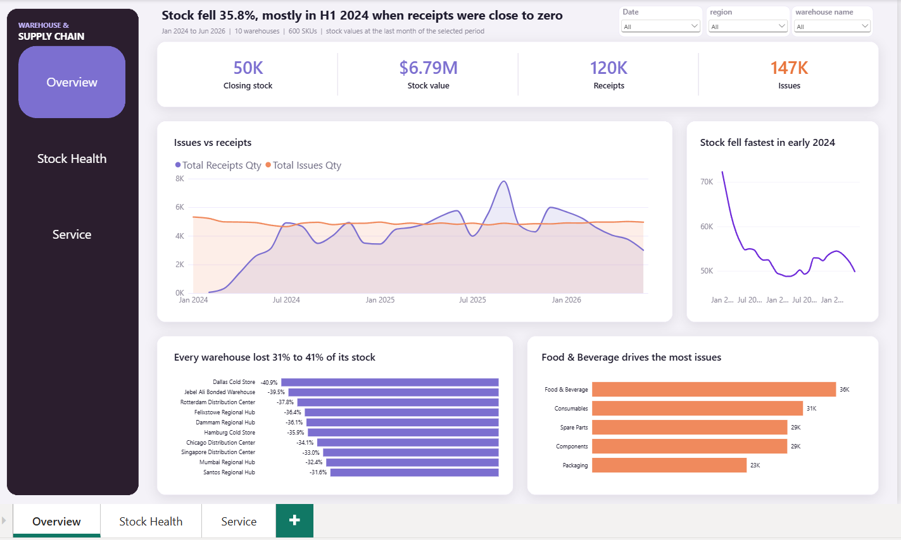
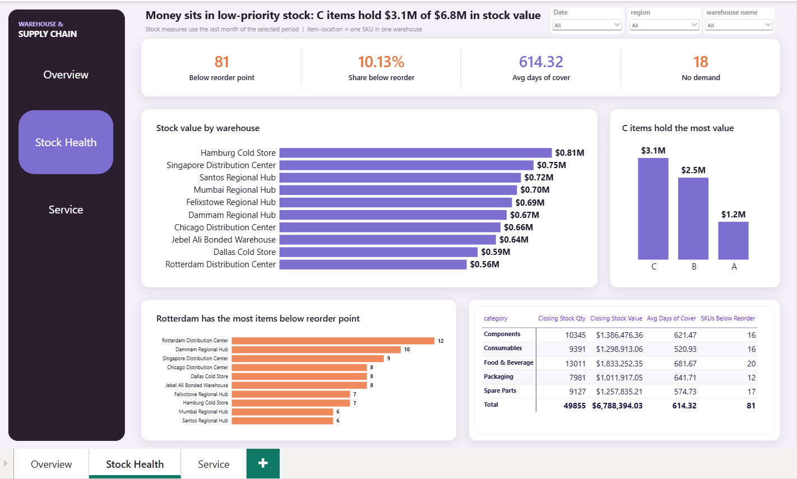
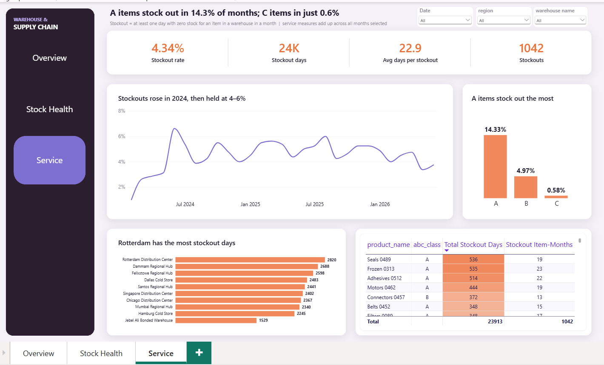
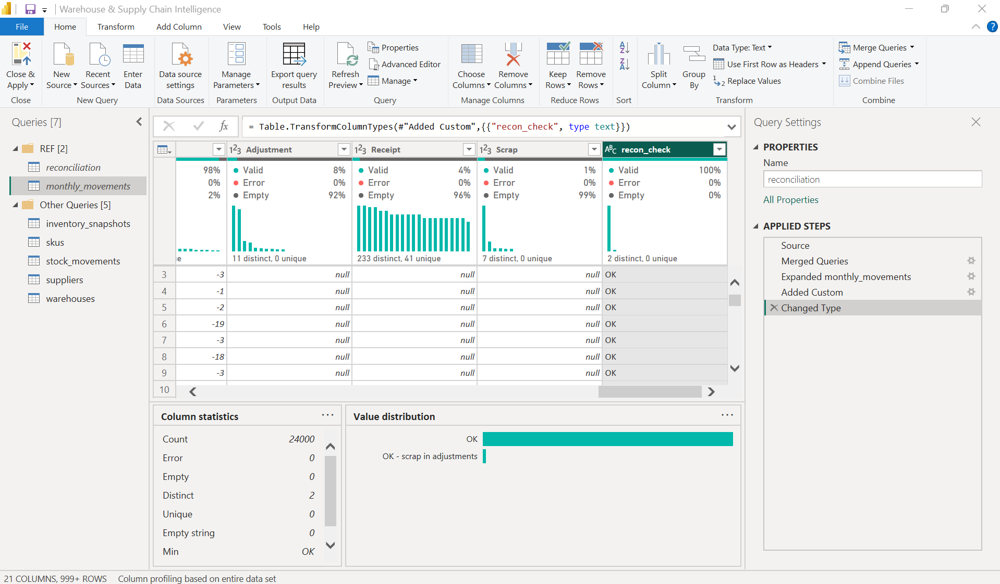
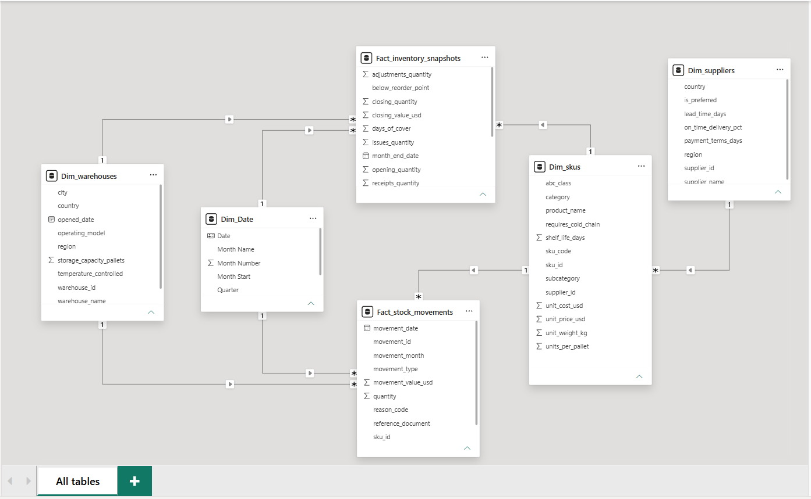

# Warehouse & Supply Chain Intelligence (Power BI)

A Power BI report that answers three questions for a warehouse and purchasing manager: **what happened to stock, where is money tied up, and where are customers let down?** It covers 10 warehouses, 600 SKUs and 49,520 stock movements from January 2024 to June 2026.



## Key findings

| # | Finding | Number |
|---|---|---|
| 1 | Stock fell by more than a third, mostly in the first half of 2024, when receipts were close to zero | **−35.8%** (77,630 → 49,855 units) |
| 2 | Issues outran receipts over the period | 147,178 issued vs 120,202 received |
| 3 | Money sits in low-priority stock | C items hold **$3.1M of $6.8M** in stock value; A items hold $1.2M |
| 4 | The most important items run out most often | A items stock out in **14.3%** of item-months; C items in **0.6%** |
| 5 | A stockout lasts close to a month on average | **22.9 days** per stockout (23,913 days over 1,042 stockouts) |
| 6 | Every warehouse lost stock; Rotterdam shows the most stress | All warehouses fell 31–41%; Rotterdam has the most items below reorder point (12) and the most stockout days (2,820) |

**Recommendations**
- Shift purchasing budget from C items to A items, and raise safety stock and reorder points for A items first.
- Cut or pause reorders for slow C items and clear the item-locations with no demand.
- Review Rotterdam's replenishment schedule and reorder points.
- Set a minimum monthly receipt plan so a supply gap cannot drain stock again.

## Report pages

| Page | Question | Main visuals |
|---|---|---|
| **Overview** | What happened to stock? | KPI strip, receipts vs issues, stock trend, decline by warehouse, issues by category |
| **Stock Health** | Where is money tied up? | Stock value by warehouse and ABC class, items below reorder point, category table |
| **Service** | Where do customers lose out? | Stockout rate trend, stockout rate by ABC class, stockout days by warehouse, top SKUs |

| Stock Health | Service |
|---|---|
|  |  |

## Data

Five CSV files from the *Global Warehouse Inventory & Stock 2024–2026* dataset, downloaded from the [Prime Levels Data Hub](https://prime-levels.com/data-hub). The data appears to be synthetic. The CSV files are **not** stored in this repository; download them and point the `DataFolder` parameter at their folder (see *How to reproduce*).

| Table | Rows | Grain |
|---|---|---|
| stock_movements | 49,520 | One row per stock movement (receipt, issue, adjustment, scrap) |
| inventory_snapshots | 24,000 | One row per warehouse, SKU and month |
| skus | 600 | One row per SKU |
| suppliers | 40 | One row per supplier |
| warehouses | 10 | One row per warehouse |

## Data cleaning and validation

The work followed one rule: **verify first, change only what is wrong.** Every step ran in Power Query with column quality, distribution and profile switched on and set to profile the **entire dataset**, not the first 1,000 rows.

### Process

| Step | What was checked | How |
|---|---|---|
| 1. Profile | Types, errors, blanks, distinct counts per column | Column quality / distribution / profile on the full dataset |
| 2. Data types | Every column has the right type | Column headers, then min/max on dates and numbers |
| 3. Blanks and zeros | Where values are missing, and why | Filtered blank rows and compared with related columns |
| 4. Keys | Primary keys unique; foreign keys exist in their dimension | Distinct = unique counts; Left Outer and Left Anti merges |
| 5. Business rules | Signs, formulas and flags behave as the business expects | Temporary check columns, Group By, then removed |
| 6. Reconciliation | Monthly snapshots agree with the movement log | Pivoted movements per warehouse, SKU and month, merged on three keys |
| 7. Continuity | Each month starts where the last one ended | DAX `LOOKUPVALUE` with `EDATE(-1)` |
| 8. Redundancy | Columns repeated across tables say the same thing | DAX `RELATED` comparison against `skus` |

### Problems found and how they were fixed

| # | Problem | Impact if left | Fix |
|---|---|---|---|
| 1 | `movement_date` and `month_end_date` loaded as **text**. The source writes dd-MM-yyyy; the machine locale is US (MM/dd/yyyy). | A plain type change failed on every month-end date, and would have **silently swapped day and month** for any date up to the 12th (05-04 read as 4 May, not 5 April). | *Change Type → Using Locale → Date, English (UK)*, added as its own step. 0 errors after; ranges checked (1 Jan 2024 to 30 Jun 2026). |
| 2 | Numeric columns in `inventory_snapshots` **reverted to text** after the original type step was lost while fixing the dates. | Sums and averages would not work; blank cells stayed as empty strings instead of nulls. | Re-typed quantities, `reorder_point` and `stockout_days` as whole numbers, `closing_value_usd` and `days_of_cover` as decimals. Empty strings became nulls. |
| 3 | `supplier_id`, `unit_cost_usd` and `abc_class` **duplicated** in the fact tables. | Two sources of truth for the same attribute; risk of filtering on the wrong copy. | Proven identical to `skus` on every row, then removed from the facts in Power Query. |
| 4 | **31 supplier names for 40 suppliers**: different suppliers share a name. | Grouping by name would merge different suppliers. | Reports group by `supplier_id`, not the name. |
| 5 | Data file paths **hard-coded** in five queries, including the local user folder. | The project breaks on any other machine and exposes a personal path. | One `DataFolder` parameter; all five tables read from it. |
| 6 | Helper queries used for reconciliation would load into the model. | Extra tables in the model and the report field list. | Grouped in a `REF` folder with **Enable load** off. |

### Kept on purpose

| Value | Count | Why it stays |
|---|---|---|
| Zero quantities | many | Real stock positions, not missing data |
| Blank `days_of_cover` | 543 of 24,000 (2.3%) | All have zero issues, so cover cannot be calculated. A zero would wrongly signal an item about to run out. |
| Adjustments from −5 to +5 | 2,012 rows | Normal stock-count corrections; no zero adjustments; net −268 units |

### Validation results

| Check | Result |
|---|---|
| Closing = opening + receipts − issues + adjustments | 24,000 / 24,000 rows match |
| Snapshots vs movement log | 0 mismatches; **scrap is recorded inside adjustments** in the snapshots |
| Opening stock = prior month's closing | Every month, every item |
| Movement value = quantity × unit cost | 100% match |
| Sign rules | Receipts positive; issues and scrap negative; adjustments both ways |
| Supplier only on receipts | 984 / 984 receipts have a supplier; all other movement types have none |
| Foreign keys | Suppliers 984/984, warehouses 49,520/49,520, SKUs 49,520/49,520 matched |
| Primary keys | warehouses 10, skus 600, suppliers 40: all unique, no blanks |
| `below_reorder_point` flag | Matches closing quantity < reorder point on all 24,000 rows |



## Data model

Star schema with two fact tables, four dimensions and six one-to-many, single-direction relationships. Redundant columns (`supplier_id`, `unit_cost_usd` and `abc_class` copied in fact tables) were proven identical to `skus` and removed.



| Table | Type | Grain |
|---|---|---|
| Fact_stock_movements | Fact | One row per movement |
| Fact_inventory_snapshots | Fact | One row per warehouse, SKU and month |
| Dim_Date | Dimension (DAX `CALENDAR`) | One row per day, marked as date table |
| Dim_warehouses, Dim_skus, Dim_suppliers | Dimensions | One row per key |

## DAX measures

24 measures in a dedicated `_Measures` table, grouped into display folders.

- **Flow measures** (receipts, issues, scrap, adjustments, stockout days) add up over time.
- **Stock measures** are **semi-additive**: they add across warehouses and SKUs but use only the last month in the selected period.

```dax
Closing Stock Qty =
VAR LastMonth = MAX ( Fact_inventory_snapshots[snapshot_month] )
RETURN
    CALCULATE (
        SUM ( Fact_inventory_snapshots[closing_quantity] ),
        Fact_inventory_snapshots[snapshot_month] = LastMonth
    )
```

```dax
Stockout Rate % =
DIVIDE ( [Stockout Item-Months], COUNTROWS ( Fact_inventory_snapshots ) )
```

## Tools

Power BI Desktop · Power Query (M) with a folder parameter · DAX · PBIP / PBIR project format · Git and GitHub

## Repository structure

```
├── WarehouseSupplyChain.pbip              open this file
├── WarehouseSupplyChain.Report/           pages, visuals, theme, backgrounds
├── WarehouseSupplyChain.SemanticModel/    tables, Power Query steps, measures, relationships (TMDL)
├── images/                                                       screenshots for this README
└── README.md
```

## How to reproduce

1. Install Power BI Desktop and enable *Power BI Project (.pbip) save option* under Preview features.
2. Download the five CSV files from the dataset source into one folder.
3. Open the `.pbip` file, go to **Transform data → Manage parameters**, and set `DataFolder` to that folder, ending with a backslash (for example `C:\Data\warehouse\`). All five tables read their file from this one parameter.
4. Click **Close & Apply**, then **Refresh**.

## Limitations

- The dataset appears to be synthetic; the near-zero receipts in early 2024 may be an artifact of how the data was generated rather than a real supply failure.
- Average days of cover (614) is skewed by a few heavily overstocked items; a median would be a fairer summary.
- The source formula for `days_of_cover` was not independently verified.
- Unit costs and ABC classes are fixed per SKU for the whole period.

## Author

**Wael Alanazi** · Data Analyst · [LinkedIn](https://www.linkedin.com/in/wael-alanazi-3501b2284/)
